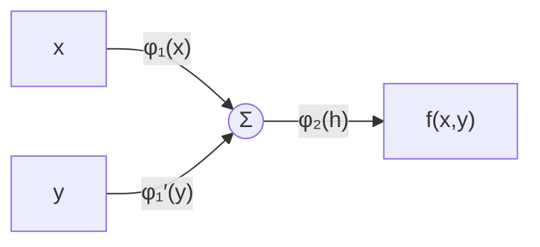
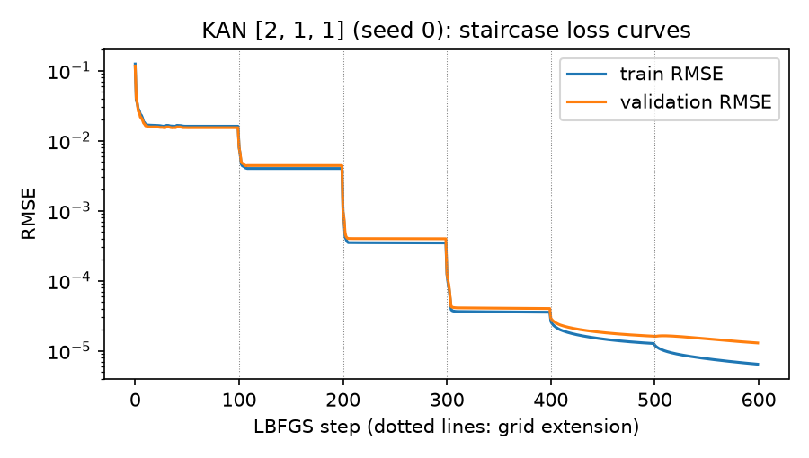
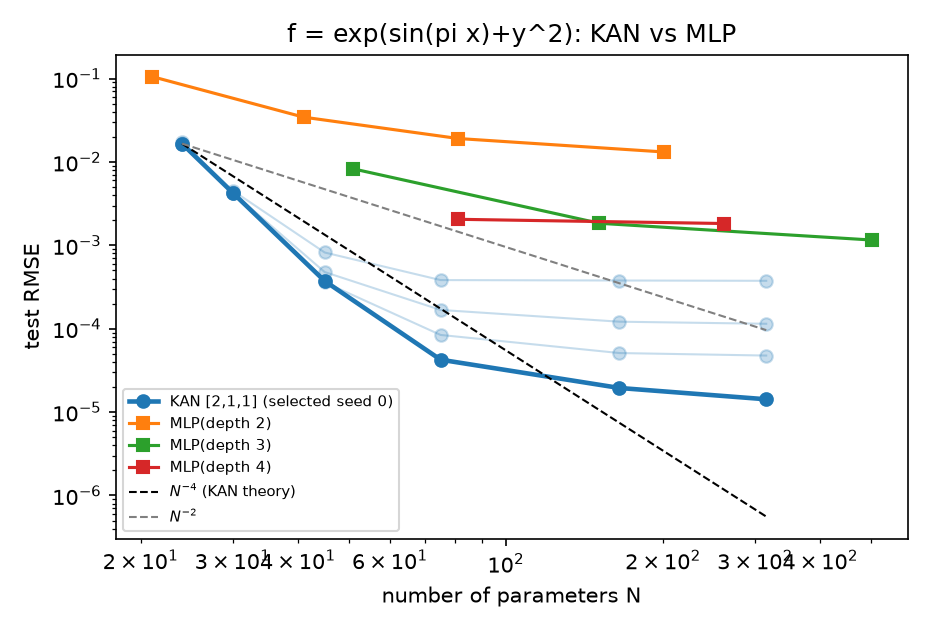
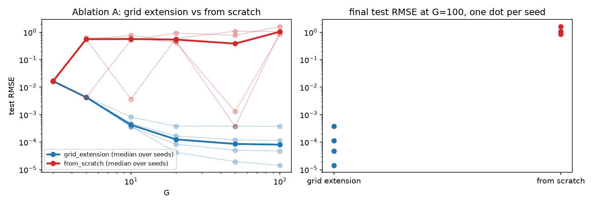

<div align="center">

# 🧮 KAN, built from scratch

### Kolmogorov–Arnold Networks: implementation, reproduction, and an honest look at what holds up

*What if the activation functions were the part you learn?*


[Notebook](notebooks/KAN_paper_implementation.ipynb) · [Report (PDF)](reports/report.pdf) · [Slides](reports/KAN_presentation.pptx) · [Results](results/)

</div>

---

Deep Learning 2026 paper-implementation project · **Dhruv (24CS3018), RGIPT** · paper: Liu et al., *KAN: Kolmogorov–Arnold Networks*, [arXiv:2404.19756v5](https://arxiv.org/abs/2404.19756)

## 💡 The idea in 20 seconds

| | **MLP** | **KAN** |
|---|---|---|
| Learnable part | weights on edges | a **1-D function on every edge** (a B-spline) |
| Nodes | apply a fixed activation | **only sum** |
| One edge | `w · x` | `φ(x) = w_b·silu(x) + w_s·Σ cᵢ Bᵢ(x)` |
| Selling point (paper) | universal approximation | better scaling on small compositional tasks, readable edges |


For `f(x,y) = exp(sin πx + y²)` a tiny `[2,1,1]` KAN can learn `sin`, `y²` and `exp` directly on its three edges.

## 🛠️ What is implemented (all KAN code written from scratch)

- **B-splines** via the Cox–de Boor recursion, checked against SciPy
- **KAN layers and networks** (Eq. 2.5–2.12) with the paper's initialisation
- **Grid update and grid extension** by least squares (Eq. 2.16)
- **Sparsification and pruning** (L1 + entropy loss, Eq. 2.17–2.21)
- **Symbolic simplification**: fit `c·f(ax+b)+d` per edge, compose a SymPy formula
- **Tasks**: Feynman symbolic regression, Poisson PINN, MNIST, each with **equal-parameter MLP baselines**
- **20 unit tests** (1 CUDA test skipped without a GPU). LBFGS, autograd, `lstsq` and SymPy come from libraries; nothing KAN-specific does.

## 📈 Results at a glance

Every number below comes from the CSVs in [`results/`](results/) and is also in the [report](reports/report.pdf).

### Reproduction on `exp(sin πx + y²)` (reduced scale)

<p align="center"> </p>

| Claim from the paper | Here |
|---|---|
| Staircase loss under grid extension | ✅ reproduced |
| Power-law error decay vs grid size (≈ G⁻³) | ✅ slope **3.15** for G ≤ 20, but **2.02** over G ≤ 100 (error saturates) |
| KAN beats an equal-size MLP | ✅ best seed **1.8×10⁻⁵** with 315 parameters vs best MLP **1.2×10⁻³** with 501 (≈ 64×) |
| …robustly | ⚠️ only **1 of 4 seeds** reaches that regime; the median KAN (3.4×10⁻³) is worse than the best MLP |
| Interpretable edges | ✅ learned edges match `sin πx`, `y²`, `exp` (\|corr\| = 1.000) |

### Ablations

| Question | Finding |
|---|---|
| Grid extension vs training from scratch | Extension helps for **G ≥ 20** (3/4 seeds succeed vs 0–1/4). At G = 5, 10 from-scratch did *better* (3/4 and 4/4 vs 1/4 and 2/4): a seed that fails early passes the failure down the chain. |
| Spline order k = 1, 2, 3 | Higher order lowers the error (9.8×10⁻⁴ → 1.4×10⁻⁴ → 2.4×10⁻⁵ at G = 50); slopes 1.86 / 2.31 / 2.46 stay below the theoretical k + 1 |

<p align="center"></p>

### Beyond the showcase task (single seed each)

| Task | Outcome |
|---|---|
| **Feynman (6 equations)** | KAN beats an equal-parameter MLP on 3 (I.12.11, I.27.6, I.44.4), ties on 1, loses on I.6.2 (~20×) and II.35.18 (~41×) |
| **Symbolic recovery** | ❌ none of the six target formulas recovered; best symbolic RMSE 2.6×10⁻³ |
| **Poisson PDE** | KAN error falls 9.1×10⁻³ → 6.4×10⁻⁴ as G goes 3 → 20; MLP wins at ≈240–300 parameters, KAN is best only at ≈750 (by 13%) |
| **MNIST** | MLPs **97.2–97.5 %** vs KANs **94.1 % / 92.3 %** at matched parameters; a KAN epoch is ~4–5× slower |

> **Bottom line:** the paper's claims reproduce for the small compositional function it showcases, and do **not** extend cleanly to the other tasks tested here. Reported as measured, including the parts that go against the paper.

## 🚀 Quick start

```bash
git clone <this-repo> && cd <this-repo>
pip install -r requirements.txt
pytest -q                                    # 20 passed, 1 skipped (no GPU)
jupyter notebook notebooks/KAN_paper_implementation.ipynb
```

- The notebook is organised in parts: **A** reproduction + ablations (~3 min with the saved `results/`), **B** Feynman + symbolic simplification, **C** PDE, **D** MNIST. Set `SMOKE = True` in the setup cell for a ~1 min dry run on tiny settings (numbers meaningless).
- Rebuild the report tables and PDF from the CSVs:
  ```bash
  python scripts/make_report_tables.py && cd reports && latexmk -pdf report.tex
  ```
- Full re-run of Part A experiments: `python scripts/run_experiment.py` (~35 min on one CPU thread), `python scripts/run_ablation.py`.

## 🗂️ Repository map

```
src/          kan.py (core) · symbolic.py · feynman.py · pde.py · mnist.py · train.py · models.py
tests/        unit tests (B-splines vs SciPy, grid extension, pruning, symbolic fit, PDE residual, ...)
notebooks/    the main deliverable: markdown + code, results generated from src/
results/      CSV/JSON of every run
figures/      plots used in the README, report and slides
reports/      IEEE-style report (report.tex, report.pdf) and presentation (KAN_presentation.pptx)
docs/         paper analysis, experiment plan, completion checklist
configs/      one YAML config for all experiments
scripts/      experiment runners, notebook builder, report-table generator
```

## ⚠️ Caveats

- Reduced scale: G ≤ 100 (paper: 1000), 100 LBFGS steps per grid (paper: 200), ≤ 4 seeds in Part A and **one seed** for Feynman, PDE and MNIST. No statistical tests.
- Where the paper is silent I chose: knot placement, the definition of an LBFGS "step", MLP activation (SiLU), Feynman sampling ranges. The paper's own numbers are therefore not directly comparable.
- Results are seed- and thread-count-dependent (LBFGS finds different local minima).
- The report uses an IEEE-style two-column article layout, not the official `IEEEtran` class.

## 📚 Reference

Z. Liu, Y. Wang, S. Vaidya, F. Ruehle, J. Halverson, M. Soljačić, T. Y. Hou, M. Tegmark, *KAN: Kolmogorov–Arnold Networks*, arXiv:2404.19756v5, 2025. Only the paper was consulted; no external KAN repository was read or copied.
